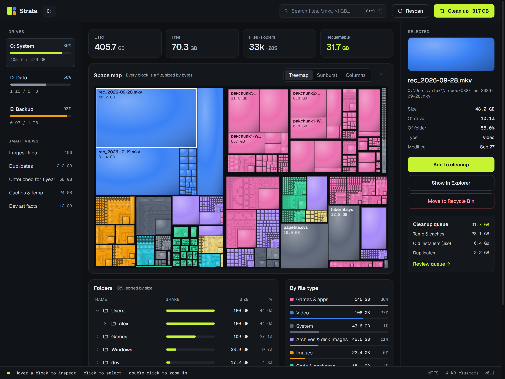
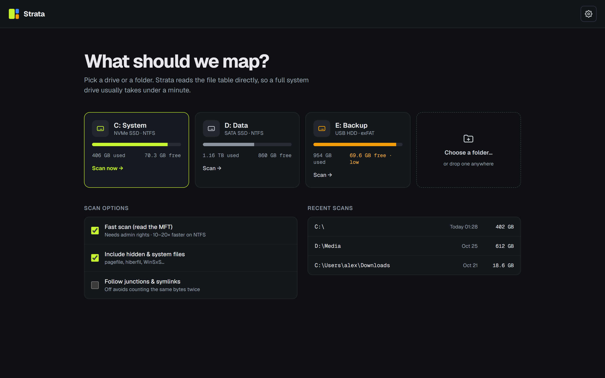
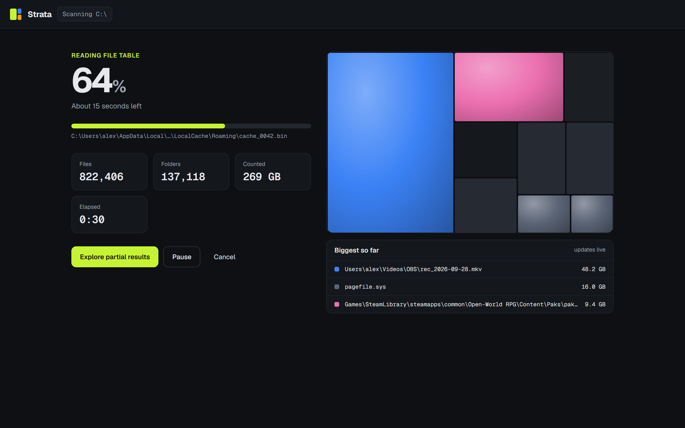
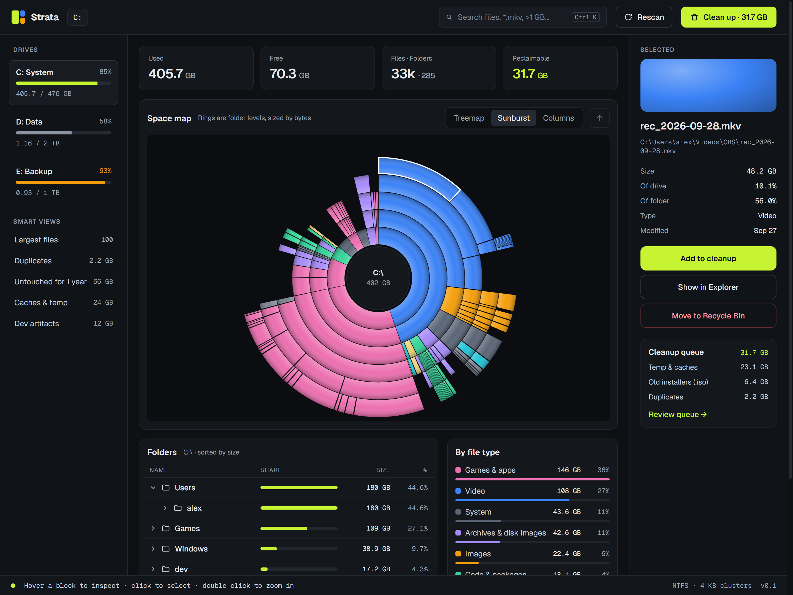
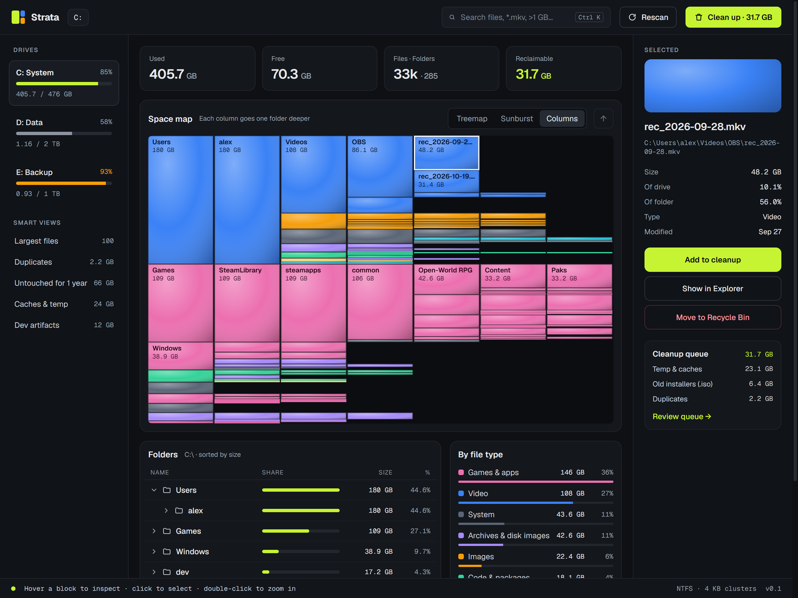
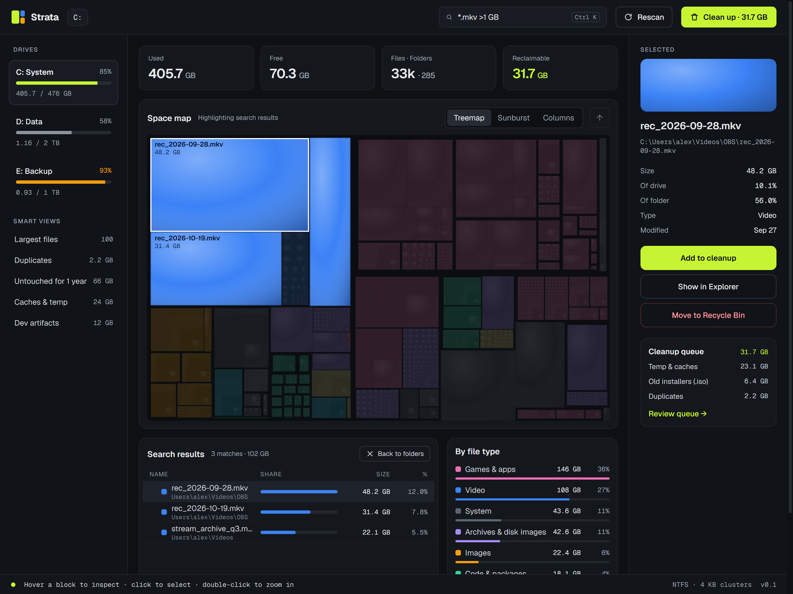
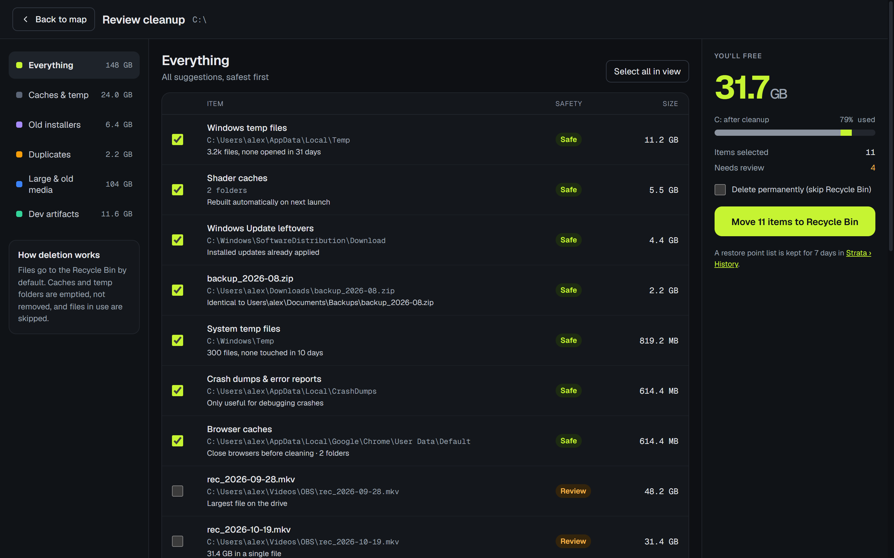

<p align="center">
  
</p>

<h1 align="center">Strata</h1>

<p align="center">
  <b>See what fills your disk, then clean it up.</b><br>
  A fast, modern disk space analyzer for Windows and Linux, in the spirit of WinDirStat.
</p>

<p align="center">
  <a href="https://github.com/florentvdry/strata/releases/latest"></a>
  <a href="https://github.com/florentvdry/strata/releases"></a>
  <a href="https://github.com/florentvdry/strata/actions/workflows/build.yml"></a>
  
  <a href="LICENSE"></a>
</p>

<p align="center">
  <a href="#download">Download</a> ·
  <a href="#features">Features</a> ·
  <a href="#screenshots">Screenshots</a> ·
  <a href="#usage">Usage</a> ·
  <a href="#building-from-source">Build</a> ·
  <a href="docs/ARCHITECTURE.md">Architecture</a>
</p>

<p align="center">
  
</p>

---

## Download

Grab the latest version from the [**Releases page**](https://github.com/florentvdry/strata/releases/latest):

| | File | Notes |
|---|---|---|
| **Installer** | `Strata-Setup-<version>.exe` | Installs for your user account (no admin needed), adds Start menu and desktop shortcuts, uninstalls from *Settings › Apps*. |
| **Portable** | `Strata-<version>-Portable.exe` | A single file. Nothing is installed: settings and saved scans live in a `Strata Data` folder next to the `.exe`. |

Requires Windows 10 or 11 (x64). Each release lists SHA-256 checksums for verification.

> [!NOTE]
> The builds aren't code-signed yet, so Windows SmartScreen may say *"Windows protected your PC"*. Click **More info › Run anyway**.

### Linux

Strata runs on the common x64 distributions. Pick the package for yours:

| Distribution | File | Install |
|---|---|---|
| Ubuntu, Debian, Linux Mint, Pop!_OS, elementary | `Strata-<version>-amd64.deb` | `sudo apt install ./Strata-<version>-amd64.deb` |
| Fedora, RHEL, Rocky, AlmaLinux, openSUSE | `Strata-<version>-x86_64.rpm` | `sudo dnf install ./Strata-<version>-x86_64.rpm` (openSUSE: `sudo zypper install …`) |
| Arch, Manjaro, EndeavourOS | `Strata-<version>-x64.pacman` | `sudo pacman -U ./Strata-<version>-x64.pacman` |
| Any distribution | `Strata-<version>-x86_64.AppImage` | `chmod +x Strata-*.AppImage && ./Strata-*.AppImage` |
| Any distribution, no install | `Strata-<version>-x64.tar.gz` | Extract and run `./strata` |

The packages add Strata to your application menu; from a terminal, run `strata`.

> [!TIP]
> On Ubuntu 24.04 and later, an AppImage or the `.tar.gz` build may quit at launch with a sandbox error, because AppArmor restricts the user namespaces Chromium uses. Install the `.deb` instead (it sets the sandbox up), or start the app with `--no-sandbox`. The AppImage also needs FUSE: `sudo apt install libfuse2t64` (or `libfuse2`), `sudo dnf install fuse-libs`.

## Features

**Map**
- **Three views of the same data:** a cushion-shaded **treemap** where every block is a file, a **sunburst** of folder rings, and **columns** that go one folder deeper each step.
- Hover to inspect, click to select, double-click to zoom in, right-click for actions. Breadcrumb and keyboard navigation included.
- **Folder tree** sorted by size, kept in sync with the map, and a **by-file-type** legend that highlights a type on the map.

**Find**
- **Search** by name, glob, size and type: `*.mkv >1 GB`, `type:video`, `backup <500MB`.
- **Smart views:** largest files, duplicates (verified by content), files untouched for a year, caches & temp, dev artifacts.

**Scan**
- **Fast scan** (Windows) reads the NTFS master file table directly, typically 10–20× faster than walking folders. It needs admin rights, and Strata offers to restart elevated and resume the scan.
- A normal scan is also quick: it walks folders on several threads, and a 560k-file system drive takes seconds on an NVMe SSD.
- On Linux, every mounted drive shows up (ext4, Btrfs, XFS, ZFS, NTFS, exFAT, network shares…). A scan stays on one file system, like `du -x`: other mounts, `/proc` and `/sys` aren't counted, hard links count once and sparse files count what they really use.
- **Live progress:** a map that fills in as folders finish, the biggest files found so far, and pause / resume / cancel. You can explore partial results while the scan keeps going, and the map refreshes in place when it finishes.

**Clean up**
- **Suggestions with reasons:** Windows temp and update leftovers, browser and shader caches, crash dumps, old installers and disk images, large old media, duplicates, `node_modules` and other build output. On Linux also `~/.cache`, thumbnails, `/tmp`, core dumps and the APT, DNF, Pacman and Zypper package caches. Each one is marked *Safe* or *Review*.
- **Safe by default:** everything goes to the Recycle Bin (the desktop Trash on Linux) unless you choose otherwise, files in use are skipped, system locations are refused, and a 7-day **History** can restore what you removed.

**General**
- **Private:** works entirely offline, with no account, telemetry or network access.
- Four accent colors, optional cushion shading, and saved recent scans that reopen instantly.

## Screenshots

<table>
  <tr>
    <td width="50%"><br><sub><b>Start:</b> pick a drive or folder, or drop one anywhere.</sub></td>
    <td width="50%"><br><sub><b>Scanning:</b> live progress and a map that fills in.</sub></td>
  </tr>
  <tr>
    <td><br><sub><b>Sunburst:</b> folder levels as rings.</sub></td>
    <td><br><sub><b>Columns:</b> each column one level deeper.</sub></td>
  </tr>
  <tr>
    <td><br><sub><b>Search:</b> matches light up on the map.</sub></td>
    <td><br><sub><b>Cleanup:</b> review, then recycle or delete.</sub></td>
  </tr>
</table>

<sub>The screenshots use a made-up drive. Regenerate them with `npm run screenshots`.</sub>

## Usage

1. **Pick something to map:** a drive card, *Choose a folder…*, or drag a folder onto the window.
2. **Explore:** the biggest blocks are the biggest files. Double-click to dive into a folder, and use the breadcrumb or <kbd>Backspace</kbd> to come back.
3. **Clean up:** use *Add to cleanup* on anything you select, or open **Clean up** in the header to review suggestions, then move them to the Recycle Bin (or Trash).

### Keyboard shortcuts

| Keys | Action |
|---|---|
| <kbd>Ctrl</kbd> + <kbd>K</kbd> | Search |
| <kbd>Enter</kbd> | Zoom into the selected folder |
| <kbd>Backspace</kbd> / <kbd>Alt</kbd> + <kbd>↑</kbd> | Zoom out to the parent folder |
| <kbd>Delete</kbd> | Move the selection to the Recycle Bin (asks first) |
| <kbd>Esc</kbd> | Close a dialog, clear the search or highlight, leave the cleanup review |

### Search syntax

| Example | Matches |
|---|---|
| `report` | Names containing "report" |
| `*.mkv` | Names matching a glob (`*` and `?`) |
| `>1 GB`, `<500MB`, `>=2gb` | Files by size (units: B, KB, MB, GB, TB; MB if omitted) |
| `type:video` | Files of a type: `video`, `image`, `audio`, `doc`, `archive`, `code`, `app`, `system` |
| `*.iso >1 GB` | All terms combined |

Search covers the folder you're zoomed into.

### Scan options

| Option | What it does |
|---|---|
| **Fast scan (read the MFT)** | Windows only. Reads the NTFS file table instead of listing folders. Needs administrator rights, and Strata offers to restart elevated. Falls back to a normal scan on other file systems. |
| **Include hidden & system files** | Counts `pagefile.sys`, `hiberfil.sys`, `$Recycle.Bin`, hidden folders… On Linux: dot-folders such as `~/.cache` and `~/.local`. |
| **Follow junctions & symlinks** | Descends into links (with loop protection). Off by default so the same bytes aren't counted twice. |

On Linux, Strata runs as your user, so folders you can't read (other users' homes, parts of `/var`) are marked and skipped, and system package caches need `sudo` to clean (each suggestion names the command).

## Safety

Strata deletes files, so it's careful about it:

- Nothing is deleted without a confirmation that lists what will go and how much space it frees.
- The **Recycle Bin is the default** (on Linux, the [freedesktop.org Trash](https://specifications.freedesktop.org/trash-spec/latest/) your file manager uses). Permanent deletion is an explicit opt-in.
- Drive roots and core system folders (Windows, Program Files, ProgramData, user profile roots; on Linux `/usr`, `/etc`, `/var`, `/home`, your home folder, mount points…) are refused.
- Temp and cache folders are **emptied, not removed**. Files in use are skipped and reported.
- Junctions and symlinks are removed as links and never followed during deletion.
- Duplicates are only pre-selected inside your personal folders (Downloads, Documents, Pictures…). Copies inside apps or tools are flagged *Review*.
- **History** keeps 7 days of what was removed and restores Recycle Bin items to their original place.

## Building from source

Prerequisites: Windows 10/11 or Linux, [Node.js](https://nodejs.org) 20 or newer (22+ for `npm run screenshots`), Git, and [Rust](https://rustup.rs) for the scanner:

- **Windows:** `rustup` with the default `x86_64-pc-windows-msvc` toolchain, which needs the [Visual Studio Build Tools](https://visualstudio.microsoft.com/visual-cpp-build-tools/) ("Desktop development with C++"). The rustup installer offers to set them up.
- **Linux:** `rustup`, plus `rustup target add x86_64-unknown-linux-musl` and your distribution's `musl-tools` (or `musl-gcc`) for the static binary that runs everywhere. Without them, the scanner is built for your own system only.

```bash
git clone https://github.com/florentvdry/strata.git
cd strata
npm install
npm start
```

| Script | Does |
|---|---|
| `npm start` | Builds the scanner if needed and runs the app |
| `npm run build:scanner` | Builds the scanner (`scanner/`, Rust) → `bin/strata-scan(.exe)` |
| `npm run dist` | Builds the installer and portable `.exe` into `dist/` |
| `npm run pack` | Builds an unpacked app into `dist/win-unpacked/` (quick to test) |
| `npm run dist:linux` | Builds the AppImage, `.deb`, `.rpm`, `.pacman` and `.tar.gz` into `dist/` (the `.rpm` needs `rpmbuild`, the `.pacman` needs `bsdtar`) |
| `npm run pack:linux` | Builds an unpacked Linux app into `dist/linux-unpacked/` |
| `npm run test:rust` | The scanner's unit tests, including the NTFS fast scan on disk images |
| `npm run test:scanner` | Runs the built scanner against a temporary folder tree: scan, pause, snapshot, duplicates, Recycle Bin / Trash, restore |
| `npm run check:fast-scan` | Windows, as administrator: checks that the NTFS fast scan finds the same tree as a folder walk |
| `npm run screenshots` | Regenerates `docs/screenshots/` from a made-up drive |
| `npm run build:icon` | Redraws `assets/icon.png` and `assets/icon.ico` |

> [!TIP]
> If `npm start` reports that Electron isn't installed, your npm may be blocking install scripts. Run `node node_modules/electron/install.js` once.

## Project structure

```
strata/
├─ scanner/                  The scanner (Rust), for Windows and Linux: folder walk, NTFS MFT reader,
│  │                         duplicate finder, Recycle Bin / Trash, deletion
│  ├─ src/platform/          What differs between Windows and Linux
│  ├─ tests/fixtures/        NTFS disk images for the fast-scan tests
│  └─ fuzz/                  Fuzz targets for the NTFS reader
├─ src/main/                 Electron main process: window, scanner processes, files, settings, history
├─ src/renderer/             UI, Preact + htm with no build step
│  ├─ views/                 Start, Scanning, Explorer, Cleanup
│  ├─ components/            Space map (treemap, sunburst, columns), dialogs, icons
│  └─ lib/                   Scan file parser and tree model, search, cleanup rules, formatting
├─ scripts/                  Scanner build and tests, icon, screenshots
├─ assets/                   App icon
└─ docs/                     Architecture notes and screenshots
```

See [docs/ARCHITECTURE.md](docs/ARCHITECTURE.md) for how the pieces fit together, and [docs/PROTOCOL.md](docs/PROTOCOL.md) for the scanner's commands, messages and scan file format.

## Where Strata keeps its data

| Version | Location |
|---|---|
| Installed | `%APPDATA%\Strata` |
| Portable | `Strata Data\` next to the `.exe` |
| Linux | `~/.config/Strata` (or `$XDG_CONFIG_HOME/Strata`) |

This folder holds the last 8 scans, settings and the 7-day cleanup history. Delete it to reset Strata.

## Contributing

Bug reports, ideas and pull requests are welcome. Please read [CONTRIBUTING.md](CONTRIBUTING.md) first, and follow the [Code of Conduct](CODE_OF_CONDUCT.md). Report security issues privately as described in [SECURITY.md](SECURITY.md).

## Acknowledgements

- Inspired by [WinDirStat](https://windirstat.net/) and its cushion treemaps.
- Built with [Electron](https://www.electronjs.org/), [Preact](https://preactjs.com/) and [htm](https://github.com/developit/htm).
- Typeset in [Geist and Geist Mono](https://vercel.com/font) by Vercel, under the [SIL Open Font License](src/renderer/fonts/OFL.txt).

## License

[MIT](LICENSE) © 2026 Florent Vandroy
