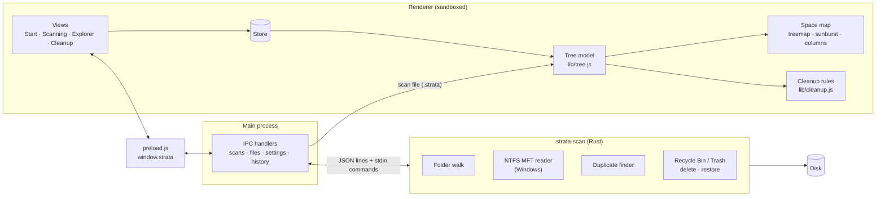
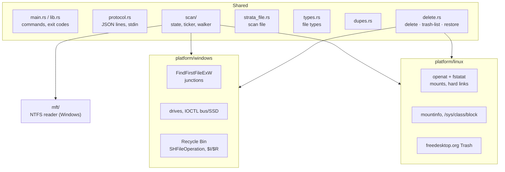

# Architecture

Strata has three parts: a small **scanner** process that touches the disk, the Electron **main process** that orchestrates it, and the **UI** that turns a scan into maps and cleanup suggestions.

The scanner is one Rust program, `strata-scan`, built for Windows and Linux from [`scanner/`](../scanner). What differs between the two systems (listing folders, drives, the NTFS fast scan, Recycle Bin vs. Trash) lives in two small platform modules behind one interface; everything else is shared. The main process and the UI only differ in small platform details: the path separator, case-sensitivity, drive names and wording.



## Scanner (`scanner/`)

A Rust console program, `strata-scan`. Release builds are static: `x86_64-pc-windows-msvc` with the C runtime linked in (no Visual C++ redistributable), and `x86_64-unknown-linux-musl` on Linux (one binary for every distribution, with mimalloc since musl's allocator serializes threads).



| Command | Purpose |
|---|---|
| `info` | Drives (label, file system, size, free space, cluster size, bus, SSD/HDD), whether the process is elevated or root, and the Trash folders. |
| `scan <path> <out> [--mft] [--hidden] [--links]` | Scans a drive or folder and writes a `.strata` file. |
| `dupes <list>` | Given same-size candidate files, finds byte-identical groups. |
| `delete <list> [recycle\|permanent]` | Deletes paths and reports what is left of each. |
| `trash-list [path]` / `restore <list>` | Recycle Bin / Trash items that may have come from a path, and putting them back. |

The full contract, with every message, is in [PROTOCOL.md](PROTOCOL.md).

### Talking to the main process

The scanner writes **JSON lines** to stdout and reads plain-text **commands** from stdin.

- During a scan, a `progress` message goes out about 5 times per second: phase, counters, current path, estimated fraction done, the top-level items with their state (pending, active, done) and dominant file type, and the biggest files so far.
- `notice` reports a fallback, such as fast scan → normal scan. `done` and `error` end the scan.
- Commands: `pause`, `resume`, `stop` (finish now with partial results) and `snapshot <file>`. A snapshot writes the current partial tree without stopping; this is what *Explore partial results* uses.

### Folder walk

A pool of 2 to 8 threads (`scan/walker.rs`) takes folders from a shared stack, depth-first. Each folder is listed once, by the platform's `DirLister`, and its items are appended to the node list in one go under a lock, so a parent always comes before its children.

- **Windows** (`platform/windows/list.rs`): `FindFirstFileExW` (large fetch, basic info) returns sizes, attributes and times without opening every file. Paths longer than 260 characters use the `\\?\` prefix.
  - Junctions and symlinks are listed but not entered, unless *Follow* is on. Then the target is resolved with `GetFinalPathNameByHandle`, and each target is entered once and never when it's an ancestor.
  - Cloud placeholders (OneDrive "online-only" files) count as 0 bytes, since they don't use local space.
- **Linux** (`platform/linux/list.rs`): the folder is opened once, and each name is `fstatat`'d relative to it, without rebuilding paths.
  - It stays on one file system: other mount points inside the scanned folder (from `/proc/self/mountinfo`) are listed (as links) but not entered, so `/proc`, `/sys` and other drives aren't counted.
  - Hidden means a name starting with `.`. Symlinks are links: not followed unless *Follow* is on, and then each target folder (by device and inode) is entered once. Real folders in a listing count as visited before its links, so a link next to the folder it points to isn't followed as well.
  - Hard-linked files count once, and a file counts its allocated size when that's smaller than its length (sparse files).

### NTFS MFT reader (fast scan, `mft/`)

With administrator rights on Windows, the scanner opens the volume (`\\.\C:`) and reads the master file table directly:

1. The boot sector gives the cluster size, the MFT position and the record size.
2. Record 0 (`$MFT`) gives the MFT's own data runs, including any continued through an `$ATTRIBUTE_LIST`.
3. All records are read sequentially in 1 MB chunks. Each record is checked (`FILE` signature and update-sequence fixups), then parsed:
   - `$STANDARD_INFORMATION` gives attributes and modification time.
   - `$FILE_NAME` gives the parent and name; Win32 names win over DOS 8.3 names.
   - The unnamed `$DATA` attribute gives the logical size, which may come from an extension record.
4. Parent references are linked into a tree, which is walked depth-first from the root (or from the scanned folder) to produce nodes in parent-before-child order.

If anything fails (not NTFS, no rights, an unexpected structure), the scanner reports a `notice` and falls back to the folder walk. Every read is bounds-checked: a damaged record is skipped, never a crash.

All reading goes through a `ReadAt` trait, so the same code reads a disk image in tests, on any OS. `scanner/tests/fixtures/` holds NTFS images made with `mkntfs` and `ntfs-3g` (`tests/make-ntfs-fixture.py`): non-resident and resident files, DOS 8.3 names, hidden and system items, sparse and compressed files, alternate data streams, a junction, hard links, a file with so many names that it needs an `$ATTRIBUTE_LIST`, and a fragmented MFT with 512-byte clusters. The tests compare the reader's tree with what the mounted file system showed, and `scanner/fuzz/` fuzzes the record and volume parsers.

### The `.strata` scan file

A compact binary format. The UI can map its sections straight into typed arrays.

```
"STRATA01"                        8 bytes
int32 headerLength                header JSON: root, fs, cluster, total, free, method,
header (UTF-8 JSON)               scannedAt, duration, partial, files, dirs, bytes, options
zero padding to 8 bytes
int32 N, int32 0
float64[N]  size                  file sizes (folders are 0, summed by the UI)
float64[N]  mtime                 Unix seconds
int32[N]    parent                -1 for the root; always smaller than the node's own index
uint8[N]    flags                 1 dir · 2 hidden · 4 system · 8 reparse · 16 access denied · 32 cloud-only
uint8[N]    type                  0 other · 1 video · 2 app · 3 system · 4 image · 5 archive · 6 code · 7 audio · 8 doc
int32 namesLength
names (UTF-8, NUL-separated)
```

Saved scans live in the data folder (`scans/`), alongside an `index.json` of recent scans.

### Drives (`info`)

- **Windows:** `GetLogicalDrives`, `GetVolumeInformation` and `GetDiskFreeSpaceEx`; bus and SSD/HDD from the storage driver (`IOCTL_STORAGE_QUERY_PROPERTY`: device descriptor and seek penalty), which needs no administrator rights.
- **Linux:** the mounted file systems from `/proc/self/mountinfo`. Pseudo file systems (proc, sysfs, tmpfs, overlay, squashfs…) and system mounts (`/boot`, `/snap`, container storage…) are left out; drives mounted under `/run/media` are kept. Sizes come from `statfs`; bus, SSD/HDD and removable come from `/sys/class/block` (through partitions, LVM and LUKS to the disk), labels from `/dev/disk/by-label`. Drives have `letter: null`; the UI names them by label or mount point.

### Recycle Bin and Trash

- **Windows** (`platform/windows/recycle.rs`): `SHFileOperation` in batches of 64, with `FOF_WANTNUKEWARNING` so Windows warns instead of deleting for good when something is too big to recycle; what fails is retried one by one. `trash-list` reads the `$I` metadata files in `X:\$Recycle.Bin\<SID>\` (versions 1 and 2), and `restore` moves the matching `$R` item back.
- **Linux** (`platform/linux/trash.rs`): the **freedesktop.org Trash**. The home Trash (`$XDG_DATA_HOME/Trash`, usually `~/.local/share/Trash`) when the item is on the same file system, otherwise `$topdir/.Trash/$uid` (when it's a sticky folder, not a link) or `$topdir/.Trash-$uid` on the item's own drive. A `.trashinfo` file with the original path and the local date is reserved with `O_EXCL` before the move, as the spec asks.
- **Permanent** deletion is shared (`delete.rs`): recursive, links and junctions removed as links, never followed; read-only attributes cleared on Windows.

## Main process (`src/main/`)

- Creates the window (sandboxed renderer, context isolation, no Node in the UI) and exposes a narrow API through `preload.js`.
- Starts the scanner for scans, duplicates and deletions, forwards progress to the UI, and mirrors scan progress on the taskbar button.
- Keeps settings, recent scans and the 7-day history as small JSON files. Writes go to a temporary file first, then get renamed.
- **Deletion:** targets are expanded (a "contents only" target, such as a temp folder, becomes its children), protected paths are refused (`src/main/platform.js`, plus the drives and Trash folders from the scanner's `info`), and the scanner does the work.
- **Restore:** asks the scanner which Recycle Bin / Trash items match a history entry (`trash-list`), then has it put them back (`restore`).
- **Restart as administrator:** relaunches through `Start-Process -Verb RunAs` and passes the pending scan along. Windows only: Linux has no file-table fast scan, and GUI apps shouldn't run as root.

## UI (`src/renderer/`)

Plain ES modules with [Preact](https://preactjs.com/) and [htm](https://github.com/developit/htm), and no build step.

- **`lib/store.js`:** one global store, plus a separate tiny store for the hovered item so mouse moves don't re-render the whole screen.
- **`lib/tree.js`:** loads a `.strata` file into typed arrays and builds:
  - folder sizes and file counts (one backwards pass, which works because parents come first),
  - each folder's children sorted by size,
  - per-folder bytes by file type, used to color folders by their dominant type.
  
  After a deletion, nodes are removed and every ancestor's numbers are updated.
- **`components/layouts.js`:** the three canvas layouts.
  - The **treemap** uses the squarified algorithm and only goes as deep as blocks stay visible; anything smaller merges into its folder's block.
  - The cushion shading is a single unit-square radial gradient, stretched per block with a canvas transform.
  - The **sunburst** and **columns** layouts share the same hit-testing and outline contract.
- **`components/map.js`:** two stacked canvases. The base holds the layout; the overlay draws hover and selection, so mouse moves never repaint the map.
- **`lib/cleanup.js`:** suggestion rules by folder name, location and age. It tracks which nodes are already covered so nothing is suggested twice, and selection totals never count a nested item twice.
- **`lib/search.js`:** parses queries (`*.mkv >1 GB type:video`) and searches the zoomed folder.

## Screenshots

`scripts/screenshots/` builds a made-up drive (`demo-data.mjs`, deterministic), launches the app against a throwaway data folder, loads the demo scan, and captures each screen through the Chrome DevTools Protocol. Run it with `npm run screenshots`.
