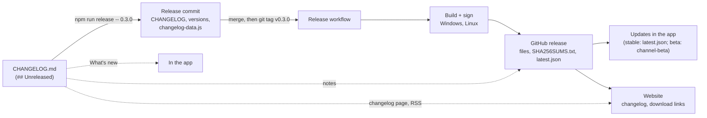

# Releasing

One command prepares a release, one tag publishes it. Everything else is automatic.



## One-time setup: update signing

The app only installs updates signed with your key. The public half is already in `src-tauri/tauri.conf.json`; the private half must be stored as the **repository secret `TAURI_SIGNING_PRIVATE_KEY`** (Settings › Secrets and variables › Actions › *New repository secret*; paste the whole content of the key file). Also keep a copy in a password manager.

A repository secret is enough here: the Release workflow reads it as it is. An *environment* secret would add protection (it can be limited to the `v*` tags and need an approval), but then the jobs that build with it must declare `environment: release`, which this setup doesn't do; if you want that, add it to the `check` job in `release.yml` and to the build jobs in `build.yml`.

Don't lose the key and don't replace the public key later: every installed Strata only trusts the key it was built with, so a new key means everyone has to reinstall by hand. If it ever has to be replaced, `npm run signing:setup -- --force` makes a new pair and prints the private key once.

The Release workflow refuses to run while the public key is a placeholder or the secret is missing.

## Writing the notes

`CHANGELOG.md` ([Keep a Changelog](https://keepachangelog.com/en/1.1.0/)) is the only place release notes are written, as the work happens:

- Under `## [Unreleased]`, add lines to **Added**, **Changed**, **Fixed**, **Removed**, **Deprecated** or **Security** for anything a user would notice. Start a line with a **bold name** for the feature and write what it means for them. Indent sub-points two spaces.
- Put CI, tests, tooling and docs under **Internal**. It stays in the file but is left out of the app, the website and the release body.
- A short paragraph under the version heading (before the first `###`) becomes the summary at the top of its notes.

`npm run check` validates the format (CI runs it): versions newest first, dates, link lines at the bottom, and that the generated `src/renderer/lib/changelog-data.js` is current (`npm run sync:changelog` rewrites it). A pull request that changes `src/`, `src-tauri/src/` or `scanner/src/` without touching `CHANGELOG.md` fails the Changelog check, unless it has the `no-changelog` label.

## Making a release

1. `npm run release -- 0.3.0` (or `0.3.0-beta.1` for a beta). It moves *Unreleased* under the new version with today's date, updates the compare links, bumps `package.json`, `package-lock.json`, `src-tauri/Cargo.toml` and `Cargo.lock`, and regenerates the app's release notes. Add `--date=YYYY-MM-DD` to set the date.
2. Review `git diff`, commit, open a pull request and merge it. (The website rebuilds on merge and will show the new version a few minutes before the files exist; tag right away.)
3. Tag the merge commit and push the tag: `git tag v0.3.0 && git push origin v0.3.0`.

The **Release** workflow then:

1. **Checks** that the tag matches `package.json`, that the changelog has notes for it, and that signing is set up.
2. **Builds** with the same jobs as CI (tests, lints, a smoke test of the built app) on Windows and Linux, with signing on.
3. **Publishes** the GitHub release (marked *pre-release* when the version has a `-`): the files below, notes from the changelog, a link to the full diff, `SHA256SUMS.txt` and `latest.json`.
4. **Refreshes the beta channel**: uploads `latest.json` to the fixed `channel-beta` pre-release too (stable's `releases/latest` skips pre-releases).
5. **Starts the website build**, which publishes the changelog page, the RSS feed and the new download links.

| File | What |
|---|---|
| `Strata-Setup-<v>.exe` | Windows installer (NSIS, per user) |
| `Strata-<v>-Portable.exe` | Windows portable: the program itself, the scanner inside |
| `Strata-<v>-amd64.deb`, `-x86_64.rpm`, `-x86_64.AppImage` | Linux packages (these three update themselves). Pre-releases have no `.rpm`: RPM versions can't contain `-`. An RPM install on the Beta channel then only gets a "new version" notice with the download page. |
| `Strata-<v>-x64.pacman`, `-x64.tar.gz` | Linux, made by `scripts/package-release.js` (updated by hand) |
| `latest.json` | The update manifest: version, notes, and per build type a URL and a signature |
| `SHA256SUMS.txt` | Checksums of every file |

If a step fails, fix it and run the workflow again for the same tag (*Re-run all jobs*); `gh release delete vX.Y.Z` first if the release was already created.

## Testing the updater

Debug builds are updated by hand, but a test can force a mode and a local manifest (debug builds only):

```bash
npm run tauri -- signer generate --ci -w /tmp/test.key           # a throwaway key (not the real one)
PUB=$(cat /tmp/test.key.pub)
(cd src-tauri && TAURI_CONFIG="{\"plugins\":{\"updater\":{\"pubkey\":\"$PUB\"}}}" cargo build)
# serve a manifest with the entry "windows-x86_64-portable" (url ending in .exe + signature from `tauri signer sign -f /tmp/test.key payload.exe`)
STRATA_UPDATE_MODE=portable STRATA_UPDATE_ENDPOINT=http://127.0.0.1:8123/latest.json ./src-tauri/target/debug/strata
```

`STRATA_UPDATE_MODE` is `portable` or `appimage` (with `APPIMAGE` set to a copy of the binary; the manifest entry is then `linux-x86_64` and the file must end in `.AppImage` and be an ELF). In both modes the running file is swapped for the downloaded one, so test on a copy of the binary. A manifest file that doesn't end the way the build expects (`.exe` for Windows, `.AppImage`, `.deb` / `.rpm`) makes the app fall back to *Open download page*.

## How the manifest picks a file

`scripts/make-update-manifest.js` writes one entry per signed file, keyed `<os>-<arch>-<build type>`; the app asks for the key matching how it was installed (see [ARCHITECTURE.md](ARCHITECTURE.md#updates-updatesrs)). `windows-x86_64` and `linux-x86_64` are fallbacks for builds that can't update themselves, so they can still say "a new version exists".
